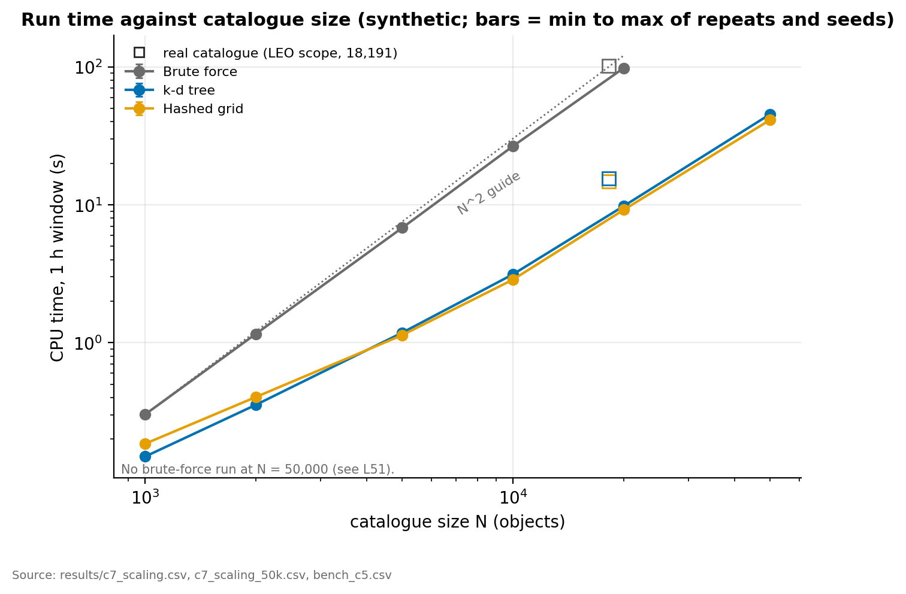

# Space Debris Tracking and Avoidance using Data Structures and Algorithms

Official implementation of the Data Structures and Algorithms course project **"Space Debris Tracking and Avoidance using Data Structures and Algorithms"** at SVKM's NMIMS MPSTME, Mumbai. 



## Abstract

Tens of thousands of active satellites and pieces of debris orbit Earth at 7 to 8 km/s in low Earth orbit. Operators must find every *conjunction*, a pair of objects that will pass closer than a screening distance, and checking every pair is O(n²) at every time step. This project implements the screening pipeline end to end: orbit propagation (Kepler, J2 and a hand-written SGP4), three screening methods (an altitude filter, a hashed uniform grid and a k-d tree) measured against an all-pairs brute-force baseline, refinement of each candidate to its time and distance of closest approach, and a conjunction graph that is clustered, ranked (Top-K) and used to plan which objects to move (greedy against exact search). The data structures are a dynamic array, linked lists, stack, queue, binary heap, chained hash table, AVL tree, k-d tree, uniform grid and disjoint-set union (union-find), all written from scratch. The base paper is Gómez et al. (2022), whose linked-cell approach we re-implement and compare directly with a k-d tree.

**Authors:** Vedant Pathak, Dhairya Shah, Kanishak Thakran

**Note:** The real catalogue is public CelesTrak data (19,440 objects, downloaded 2026-10-20) and is *not* included in this repository (see [data/README.md](data/README.md)). Synthetic catalogues come from a seeded generator and are included, with planted close pairs whose answers are known exactly. This is a simplified model for a course project, not an operational collision-avoidance tool: there are no covariances and no collision probabilities (see [docs/known_limitations.md](docs/known_limitations.md)).

## Key Results

Timings are CPU seconds on one thread, as in Table 4 of the report (means over seeds and repeats for 1,000 to 10,000; single runs for 20,000 and the real catalogue; environment in `results/environment.txt`). Window 1 h, screening distance 10 km. The k-d tree and the grid return exactly the same conjunctions as brute force (recall 100%) in every comparison; the real row uses SGP4 propagation on the LEO scope (18,191 objects).

| Catalogue | Brute force (s) | k-d tree (s) | Grid (s) | Speed-up (k-d / grid) | Pair checks removed |
|-----------|-----------------|--------------|----------|-----------------------|---------------------|
| Synthetic, 1,000 | 0.30 | 0.15 | 0.19 | 2.0× / 1.6× | 15,499× |
| Synthetic, 2,000 | 1.16 | 0.36 | 0.40 | 3.3× / 2.9× | 14,942× |
| Synthetic, 5,000 | 6.82 | 1.18 | 1.14 | 5.8× / 6.0× | 15,795× |
| Synthetic, 10,000 | 26.6 | 3.13 | 2.87 | 8.5× / 9.3× | 15,749× |
| Synthetic, 20,000 | 98.2 | 9.79 | 9.20 | 10.0× / 10.7× | 15,432× |
| Synthetic, 50,000 | not run | 45.4 | 41.3 | not available | not available |
| Real catalogue, 18,191 | 102.3 | 15.6 | 14.8 | 6.6× / 6.9× | 11,452× |

Details: `results/bench_c5_summary.csv`, `docs/fast_screening.md`. The altitude filter alone is *slower* than brute force in LEO (0.7× to 0.9×) because most objects share the same altitude band, which is reported as a finding.

### Screening distance on the real catalogue (1 h window)

| Threshold | Conjunction events | Largest cluster (objects) | Exact minimum cover |
|-----------|--------------------|---------------------------|---------------------|
| 1 km | 48 | 5 | 39 |
| 2 km | 174 | 5 | 154 |
| 5 km | 2,254 | 24 | 1,346 |
| 10 km | 12,504 | 7,197 | 3,687 |

A 5 km threshold keeps clusters small enough for exact mitigation planning; at 10 km one giant cluster appears. At 10 km the greedy plan moves 3,737 objects against the exact optimum of 3,687 (6 h window: 5,614 against 5,595). Details: `docs/experiments.md`, `docs/graph_mitigation.md`, `results/c6_summary.csv`, `results/c7_threshold.csv`.

### Quality evidence

- Line coverage 100% (1,578 of 1,578) and branch coverage 92.0% (1,635 of 1,778) over the library modules.
- Mutation check: 36 of 39 hand-written mutants killed; the three survivors are judged equivalent.
- Out-of-memory injection (6,550 injected failures), sanitizers (ASan, UBSan) and a command-line smoke test.
- Hand-written SGP4 agrees with the Python reference to a maximum of 0.86 mm on 18,635 objects.

**Details:** `docs/verification.md`, `results/c8_coverage.csv`, `results/c8_mutation.csv`, `results/sgp4_validation.csv`.

## Experiment Design

| Factor | Levels |
|--------|--------|
| Method | brute force, altitude filter, uniform grid, k-d tree |
| Synthetic catalogue size | 1,000, 2,000, 5,000, 10,000, 20,000 (and 50,000 for the two fast methods) |
| Screening distance | 1, 2, 5, 10 km |
| Time step | 5, 10, 20, 30, 60 s |
| Closest-approach refinement | bisection, linear interpolation, hybrid |
| Grid cell scale | 0.25×, 0.5×, 1×, 2×, 4× of the default |
| Real data | CelesTrak `active` plus three debris files (19,440 objects), SGP4, LEO scope 175 to 2000 km |

Every number in the report traces to a CSV in `results/` written by a script in `scripts/`. See [docs/experiments.md](docs/experiments.md).

## Repository Structure

```
Space_Debris_Tracking_And_Avoidance_using_DataStructuresAndAlgorithms/
├── src/
│   ├── ds/                 # Hand-written structures: darray, heap, queue, stack, hash,
│   │                       #   avl, kdtree, grid, dsu, vec3
│   └── *.c / *.h           # catalog, synth, propagate, sgp4, conjunction, screen,
│                           #   graph, rank, mitigate, analyze, main (CLI)
├── tests/                  # Unit, property, out-of-memory and command-line tests
├── data/
│   ├── synthetic/          # Seeded synthetic catalogues + exact planted-pair truth
│   ├── raw/                # Real CelesTrak files (git-ignored, download by hand)
│   └── README.md           # Data sources and download notes
├── scripts/
│   ├── build.sh / build.bat    # Build the program
│   ├── test.sh / test.bat      # Run all tests (Linux adds sanitizers)
│   ├── run_c6.sh, run_c7.sh    # Mitigation and experiment pipelines
│   ├── bench_c1.sh, bench_c5.sh, run_baseline.sh
│   └── *.py                    # Validation, cross-checks and plots
├── results/                # Generated metrics, CSV files and figures
├── deliverables/           # Final paper (.pdf) and presentation (.pptx)
├── paper/figures/          # Figures used in the report and this README
└── docs/                   # Scope, propagation, fast screening, graph and mitigation,
                            #   experiments, verification, limitations, future work
```

## Environment Setup

The program needs only **gcc** (C99).

```bash
gcc --version      # any recent gcc
```

Windows: install a MinGW-w64 gcc (for example `winget install BrechtSanders.WinLibs.POSIX.UCRT` or MSYS2's `mingw-w64-ucrt-x86_64-gcc`); `.bat` scripts run in Command Prompt, the `.sh` scripts need Git Bash or WSL. Verified with MSYS2 gcc 16.1.0. See [docs/running.md](docs/running.md).

The evidence scripts need Python 3 with `sgp4`, `pandas`, `numpy`, `scipy` and `matplotlib`:

```bash
pip install sgp4 pandas numpy scipy matplotlib
```

## Quick Start

### Build, test and run

| Goal | Windows | Linux / macOS |
|---|---|---|
| Build | `scripts\build.bat` | `scripts/build.sh` |
| Demo (real catalogue, needs `data/raw/`) | `scripts\demo.bat` | `scripts/demo.sh` |
| Unit and property tests | `scripts\test.bat` | `scripts/test.sh` (adds ASan + UBSan) |
| Command-line smoke test | - | `tests/cli_smoke.sh` |

### Screening commands

```bash
build/dlscms info data/raw/active.csv                       # describe a catalogue
build/dlscms gen 5000 1 build/synth5000.csv 50              # n, seed, output, planted pairs
build/dlscms screen out.csv <window_s> <step_s> <threshold_km> <flags> <fresh_days> <min_mean_motion> <catalog.csv>...
build/dlscms fastscreen <kd|grid|alt> out.csv <same arguments>
build/dlscms analyze events.csv <movable.csv|-> <K> <out_prefix> <exact_node_limit>
```

Flags: 1 = J2, 2 = drag, 4 = LEO scope (175 to 2000 km), 8 = SGP4. Real-data runs use flags 12. Full reference: [docs/running.md](docs/running.md).

### Reproduce the results

```bash
scripts/run_baseline.sh                  # brute-force baselines
scripts/bench_c5.sh 1000 2000 5000       # scaling benchmark (give catalogue sizes)
bash scripts/run_c6.sh                   # graph, clusters, Top-K, mitigation
bash scripts/run_c7.sh scaling           # also: env threshold step interp cell age summary
python3 scripts/plot_c7.py               # figures
```

### If you want the real catalogue

Download the CelesTrak GP files (`active`, `cosmos-2251-debris`, `fengyun-1c-debris`, `iridium-33-debris`) in CSV format into `data/raw/`; the exact groups and counts are in [data/README.md](data/README.md).

## Design

A seven-module pipeline: **catalogue and ingest** → **orbit propagation** → **screening engine** (altitude filter, hashed grid, k-d tree, brute-force baseline) → **closest-approach refinement** → **conjunction graph, clusters and Top-K** → **mitigation planning** → **analytics and benchmarking**. Candidate radii are inflated by the distance two objects can close in one step, which is what keeps recall at 100%.
**Details:** [docs/fast_screening.md](docs/fast_screening.md), [docs/propagation.md](docs/propagation.md), [docs/graph_mitigation.md](docs/graph_mitigation.md) and [docs/dsa_coverage.md](docs/dsa_coverage.md) (which structure is used where).

## Limitations

The model is simplified (no covariance, no collision probability, one catalogue epoch), the greedy mitigation plan is not optimal, and exact search only finishes on small components. Everything out of scope or still weak is recorded in [docs/known_limitations.md](docs/known_limitations.md) and [docs/future_work.md](docs/future_work.md). Windows: `scripts\test.bat` (all 8 unit and property tests) and `scripts\demo.bat` pass with MSYS2 gcc 16.1.0 on Windows (2026-10-25); the out-of-memory and command-line smoke tests are Linux only, and 64-bit counters on Windows remain open (L38).

## Reproducibility

- Synthetic catalogues come from a seeded generator; checksums are in `data/synthetic/SHA256SUMS`.
- Screening is deterministic; `-O0`, `-O2` and the sanitizer build give byte-identical output (checked in `tests/cli_smoke.sh`).
- Real-data results depend on the CelesTrak snapshot of 2026-10-20 (not redistributed).

## Citation

If you use this code or results, please cite:

```
@misc{pathak2026spacedebris,
  title  = {Space Debris Tracking and Avoidance using Data Structures and Algorithms},
  author = {Vedant, Kanishak, Dhairya},
  year   = {2026},
  url    = {https://github.com/withvedantpathak/Space_Debris_Tracking_And_Avoidance_using_DataStructuresAndAlgorithms}
}
```

## Contact

Vedant Pathak — [@withvedantpathak](https://github.com/withvedantpathak) [with.vedantpathak@gmail.com]

SVKM's NMIMS MPSTME, Mumbai, India
